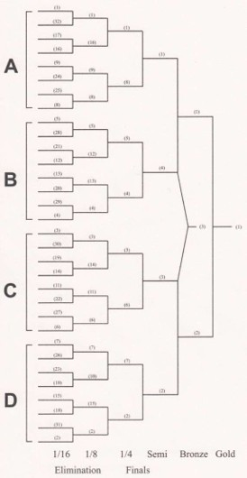

#### [(Book 2 – kap. 4.7.)](https://www.worldarchery.sport/rulebook)

##### a\) Bare recurvedivisjonen kan delta i de Olympiske Leker.
##### b\) 1440-runde som består av 36 piler skutt fra hver av følgende distanser, slik:

> 60-50-40-30 m for U18 damer (U18 = ut det kalenderåret skytter fyller 17 år) og dameveteraner \* \
70-60-50-30 m for damer, damer U21, U18 menn og herreveteraner \* \
90-70-50-30 m for herrer og herrer U21.
>
> Distansene kan skytes i omvendt rekkefølge.
>
> 122cm skive skal brukes på 90, 70 og 60 meter, og 80cm skive skal brukes på 50, 40 og 30 meter. Det kan benyttes 80cm senterskiver på 50m og 30m.
>
> \* I Norge har en del klasser andre betegnelser og/eller distanser. Dette er beskrevet i regelverk B.

##### c\) 720-runde som består av 72 piler på 70m for recurve og 72 piler på 50m for compound.

##### d\) Dobbelt 720-runde. Ved skyting av dobbelt runde er ikke konkurransen registrert for resultater på singel runde.

##### e\) Eliminasjons- og Finalerunder består av:

> 1. Eliminasjonsrunde. Her rangeres de 104 beste kvinnelige og 104 beste mannlige skyttere fra kvalifiseringsrunden \* , (se oversikten over matcher), som skyter en rekke matcher i grupper, der hver match består av inntil 5 sett av tre piler i recurve og 5 serier av tre piler for compound. \
\* Antall skyttere som kvalifiserer er annerledes i Norge
> 2. Finalenes runde. Her deltar de 8 beste skyttere som gjenstår fra eliminasjonsrunden. Disse skyter individuelle matcher, der hver match består av inntil 5 sett av 3 piler for recurve og fem serier av 3 piler for compound, og som kulminerer i en gullfinale. \
I internasjonale mesterskap skytes det en og en match etter hverandre og skytterne alternerer på å skyte ett og ett skudd.
> 3. Lagskyting (tillempet norske forhold). \
Lag som går til eliminasjons- og finaleskyting er rangert i henhold scorene i den individuelle kvalifiseringen. \
Hver match består av 4 serier av 6 piler, to fra hver av skytterne. Tiden startes og stoppes idet skytterne passerer 1-meterslinjen (se baneutlegg nedenfor).
> 4. For recurve kalles runden for Olympisk Runde og skytes på 70m på 122cm skive, mens for compound kalles den Compound Matchrunde og skytes på 50m på 80cm, 6-ringet skive.
> I internasjonale mesterskap skytes det også en såkalt mix lagkonkurranse, der laget består av én kvinne og én mann i samme divisjon. Her består matchene av 4 serier av 4 piler, to fra hver skytter.
>
> Se egen oversikt over matchprogrammet [(Diagram)](#test-me).
>
> (NB: I norske mesterskap har vi nasjonale regler for klasse- inndeling).

#### Andre runder som benyttes i Norge:
##### f\) Halv 1440-runde som består av 18 piler skutt fra hver av distansene for 1440-runden.
##### g\) 900-runde (Skandiarunde) som består av 30 piler på 122cm skive på hver av distansene 60, 50 og 40 meter.
##### h\)	60m runde for U18 består av 72 piler på 60m på 122cm skive.
#### \---------------------------------------------------
#### Andre norske runder - se regelverk B, art. 103
#### \---------------------------------------------------

##### i\) Innendørsrunder [(Book 2, Kap. 4.5.2.)](https://www.worldarchery.sport/rulebook) som kan skytes av både    av recurve- og compound-skyttere i separate divisjoner.

> 1. 18 m Innendørsrunde som består av 60 piler skutt på 40 cm skiver eller 40cm trippel-skiver.
> 2. 25 m Innendørsrunde som består av 60 piler skutt på 60cm skiver eller 60cm trippel-skiver. (Pr. 1/4-2018 er dette ikke lenger en internasjonal runde)
> 3. Innendørs Matchrunde, skutt på 40cm trippelskiver på 18m, som består av:
>    a. Eliminasjonsrunde. Her deltar de 32 beste skyttere fra kvalifiseringsrunden, som skyter en rekke matcher i grupper, der hver match består av inntil  5 sett av 3 piler.
> 4. Finalenes runde. Her deltar de 8 beste skyttere som gjenstår fra eliminasjonsrunden, og det hele kulminerer i en gull-match. \
I internasjonale mesterskap skytes det en og en match etter hverandre og skytterne alternerer på å skyte ett og ett skudd.
> 5. Vertikale trippelskiver benyttes i innendørskonkurranser.
>
> (NB: I norske mesterskap har vi nasjonale regler for Lagkonkurransen – og derfor er de internasjonale reglene for innendørs lagskyting utelatt her).

*(Dette er en oversikt over sammensetningen av matcher der 32 skyttere går videre fra kvalifiseringen)*

---