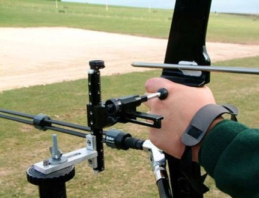

import { Aside } from '@astrojs/starlight/components';

#### [(Book 3 – art. 21)](https://www.worldarchery.sport/rulebook)'

##### Denne seksjonen er hentet og oversatt fra World Archery sitt regelverk og vil til enhver tid være å regne som underlagt de regler og retningslinjer som står i den gjeldende WA’s Book 3.    Det er primært regelverket knyttet til utøvere med VI-klassifikasjon som er oversatt, da dette er hva som er relevant for bueskyttere knyttet til NBF.

##### a\) Klassifisører (Book 3 – 21.2)
##### Utøvere med et fysisk handicap vurderes av et panel med godkjente klassifisører. Klassifisørene vil tildele en klasse til hver utøver og utstede et bevis som viser gjeldende klasse og hjelpemidler som utøveren har lov å bruke.
> a. Klassifisørenes håndbok blir justert fra tid til annen, og skal bli godkjent av WA’s Executive Board hvor den vil få status som Bylaw.

##### b\) Utøvere med nedsatt synsevne (Book 3 – 21.3)
> a. Utøvere med nedsatt synsevne, klassifiserte som VI1, skal bruke bind for øynene når de skyter. Utøvere klassifiserte som VI2 eller VI3, skal ikke bruke bind for øynene. Alle VI-utøvere klassifiseres av spesielt utnevnte VI-klassifisører. \
I Norge håndteres dette av NBF og alle skyttere skyter i«åpen klasse», W1.

##### c\) Klasser (Book 3 -21.4)
##### Følgende divisjoner og klasser er WA-godkjente for utøvere med nedsatt funksjonsevne:
> a.	Recurve (omtales ikke her) \
b.	Compound (omtales ikke her) \
c.	Visually Impaired/utøvere med nedsatt synsevne (VI) \
~~(benyttes ikke i Norge, men tas med da det er relevant for norske representanter i utlandet)~~
>>
>> i. VI1 \
ii. VI2 / VI3 \
Det skal ikke være noen forskjell mellom kvinner, menn, recurve eller compound i noen av disse klassene. Alle skyter mot hverandre innenfor hver divisjon \
>>
>> **Se utstyrsregler som gjelder spesielt for VI-utøvere i avsnitt k), pkt a.-g. nedenfor.** \
**I Norge vil alle, også VI-klassifiserte, skyte i «åpen klasse» - W1;**
>
> d. W1 åpen klasse (Recurve/Compound)
>> i. Individuell (kvinner/menn sammen) \
ii. Lag
>
> e. Utstyrsregler er stort sett de samme som ordinære regler, med følgende unntak:
>> i. Maks tyngde på buen er 45lbs \
ii. Peep-sikte og/eller scope er ikke tillatt \
iii.	Nivelleringsverktøy er ikke tillatt \
iv. Det er tillatt med slippmekanisme (Book 3 – 21.6.7) \
v. Man benytter full 80cm skive på 50meter compoundrunde og 50 meter compound match-runder
>
>f. Deltakerbegrensning W1 (omtales ikke her)

##### d\) Klassifiseringskort (Book 3 – 21.5)
> a. Alle utøvere må ha tilgjengelig et godkjent klassifiseringskort som skal vises dommerne under utstyrsinspeksjonen. Dette gjør at dommerne kan sjekke hjelpemidler til bruk sammen med øvrig utstyrskontroll. Utøvere som ikke har et godkjent klassifiseringskort, eller ikke kan vise til at dette er søkt om og under behandling, tillates ikke å stille i en divisjon/klasse for personer med nedsatt funksjonsevne. \
b. Klassifiseringskortet utdeles av forbund (NBF), tilsvarende som attest for sittende gjøres i dag. Egne prosedyrer må følges for søknad til World Archery. \
c. Utøvere som ennå ikke har mottatt klassifiseringskort skal tillates å stille i konkurransen, men oppnådde poeng kan ikke brukes for ranking, rekorder, eller til å innhente titler.

##### e\) Hjelpemidler (Book 3 – 21.6)
> a. Kun godkjente hjelpemidler er tillatt og disse skal være listet på utøverens klassifiseringskort. Utøvere som ikke lengre møter kriteriene som kreves for å kunne stille som en med nedsatt funksjonsevne, kan allikevel benytte godkjente hjelpemidler for å kunne skyte. Hjelpemidlene som kan brukes er:
>> i. Rullestol (omtales ikke her) \
ii.	Stol (omtales ikke her) \
iii.	Kloss/fotstøtte (omtales ikke her) \
iv.	Tillatt støtte for kroppen (omtales ikke her) \
v.	Proteser (omtales ikke her) \
vi.	Slippmekanisme (omtales ikke her) \
vii.	Bue festet til arm (omtales ikke her)   \
viii.	Buearm støtte (splint) (omtales ikke her) \  
ix.	Strengarm støtte (splint) (omtales ikke her)  \
x. Assistent (omtales ikke her, se eget pkt vedr assistent for VI)

##### f\) Runder (Book 3 - 21.7) (omtales ikke her, se eget pkt vedr runder for VI)
##### g\) Konkurranser (Book 3 - 21.8) (omtales ikke her)
##### h\) Verdensrekorder og merker (Book 3 - 21.9) (omtales ikke her)
##### i\) World Ranking list (Book 3 – 21.10) (omtales ikke her)
##### j\) Arena (Book 3 – 21.11) (omtales ikke her)

##### k\) VI-utøvere (Visually Impaired) (Book 3 – 21.12)  Gjelder også VI-utøvere som i Norge skyter i «åpen klasse»

> a. Det er to divisjoner for VI-utøvere, VI1 og VI2/VI3. VI2/VI3-utøvere er de som har fått IBSA-archery klassifikasjon type B2 eller B3, som defineres basert på graden av hvor synets skarphet. Utøvere i VI1 skal bruke bind for øynene. Utøvere i VI2/VI3 skal ikke bruke bind for øynene. \
Utøvere i begge VI-klassene skal bruke taktilt sikte (se bilde 2: eksempel på taktilt sikte). Ingen andre siktemidler er tillatt. \
 \
_Bilde 2: Eksempel på taktilt sikte_
>
> b. Bind for øynene kan være i form av sovemaske, briller eller svømmebriller. Disse sjekkes av dommer under utstyrsinspeksjon og kan bli sjekket på nytt underveis i konkurransen. \
>
>c. Når man er på arenaen skal bind for øynene brukes hele tiden. Dette inkluderer når man setter sammen utstyret, under trening og til man er ferdig med dagens konkurranse.
>
>d.	Siktets stativ må ikke stå i veien for andre utøvere. Stativets ben skal ikke stå bredere enn 80cm. \
Bredden på stativets fotmerke (som er i kontakt med skytters fot) skal ikke være mer enn 6cm. \
Det skal være minst 90cm avstand mellom det enkelte stativ (målt fra nærmeste punkt mellom stativene). \
Størrelsen på det taktile siktet skal ikke være mer enn  2 cm i noen retning. Dette skal kun være i kontakt med utøvers hånd eller underarm.
>
> e. Stativet kan bli stående så lenge skytter er i konkurranse. Ved dagens- eller konkurransens slutt skal stativet fjernes.
>
> f. I VI Olympisk runde, vil mattetildelingen ikke endres selv om to VI-skyttere ikke skyter ved siden av hverandre.
>
> g.	Utøvere kan skyte enten Recurve eller Compound i samme klasse.
Compound-buen kan skytes med fingre eller en slippmekanisme.
Compund-buen kan ikke være tyngre enn 45lbs (gjelder både kvinner og menn).
>
> h. Skyterunder
>> i. VI Utendørs runde består av 4x36 piler på 30m, med følgende skiver i rekkefølge: \
>> - 36 piler på 60cm skive
>> - 36 piler på 80cm skive
>> - 36 piler på 80cm skive
>> - 36 piler på 122cm skive
>>
>> ii. VI 30m runde består av 72 piler på 30m, 80cm skive \
iii.	VI Olympisk runde skytes på 30m på 80cm skive \
iv.	VI Innendørs runde består av 60 piler på 18m, 60cm skive. «Recurve 10-sone» benyttes også for de som skyter med compound-bue. \
v.	VI Innendørs match-runde skytes på 60cm skive og følger ellers samme regler som for vanlig innendørs match-runde. «Recurve 10-sone» benyttes også for de som skyter med compound-bue. \
vi.	Ellers benyttes World Archery regelverk
>
> i. Assistent
>> i. En VI-utøver har tillatelse til å ha en assistent sittende eller stående bak seg, 1 meter bak skytelinja. \
ii.	Assistentens funksjon er å fortelle utøver pilenes posisjon i skiva, samt opplyse om sikkerhetsrelaterte situasjoner som oppstår. \
iii. Assistenten skal ikke forstyrre andre utøvere. \
iv. Når utøver har gjort ferdig sin skyting, skal assistenten gå bak ventelinja. Utøver kan bli værende på skytelinja mens øvrig skyting pågår, eller gå bak ventelinja. \
v. Assistenten kan kun justere på siktet/utstyret etter at trening/gjeldende skyting er ferdig. Assistenten kan følge skytter mellom skytelinje og skiver. Mens skyting pågår kan utøver justere på eget taktilt sikte etter behov. \
vi.	Assistenten skal føre scorekort for utøver. Hver utøver skal signere eget scorekort. \
vii. Utøver og assistent skal være gjenkjennelige som «partnere» med samme uniform/bekledning. \
viii. Under individuelle matcher kan en VI-utøver ha en assistent eller trener, ikke begge deler.

<Aside type='note'>World Archery tillater ikke bruk av førerhund på skytebanen.</Aside>
---
